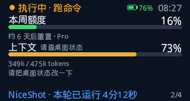
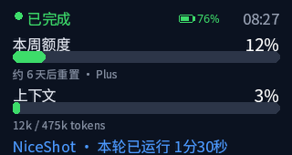
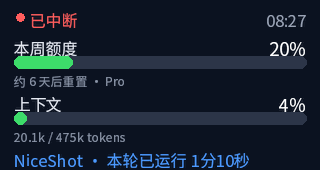
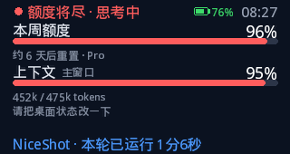
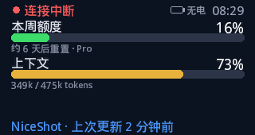
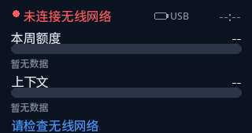

# Codex 桌面状态屏

一块 LilyGO T-Display-S3 放在桌上，显示当前 Codex 这一轮在做什么、本周额度用了多少、上下文窗口占了多少。登录凭证只留在 Mac 上，开发板只拉一份不含密钥的 JSON。

屏幕是 320×170 横屏，文案是简体中文。正在跑命令时大致是这样：



橙色是进行中，绿色是这一轮结束，红色是被中断、额度快用尽，或和电脑失去联系。进度条低于 55% 为绿色，55% 到 85% 为琥珀色，再高为红色。一轮从「执行中」变成「已完成」时，屏幕会白闪一下。时钟左边是这块 T-Display-S3 自己的电池；有多页时右下角是 `2/4` 这样的页码。

## 两段怎么分工

1. Mac 上的 `host/codex_status.py` 只读 `~/.codex/sessions/**/*.jsonl`，在局域网提供 `GET /status`。它不打开 `~/.codex/auth.json`，也不保存提示词和命令内容。
2. 开发板连上 Wi-Fi，用 mDNS 找 `codex-status.local`，失败再用 `config.h` 里的备用地址，然后把 JSON 画出来。固件里没有 OpenAI / Codex 的 token。
3. 可选的 hook 只是让「开始一轮 / 调用工具 / 结束」更快反映到屏幕上。额度数字仍然来自会话日志。

CLI 和 ChatGPT 应用的 Codex 共用 `~/.codex/sessions/`。正在跑的窗口各占一页，大约每 4 秒翻一页；只有一页时不翻。一页就是一个真正在跑的会话（主聊天窗口，或其他同时在跑的会话，包括带着自己上下文的子代理）。空闲、已结束、或超过 30 分钟没有新写入的会话不占页。子代理文件（`session_meta` 里的 `parent_thread_id`，或 `source.subagent` / `thread_source` 标成子会话）即使写得更晚，也不会换成父会话的上下文；它自己在跑时单独成页。

用户正在聊的主会话是最近写入、且不是子代理的那个。这一页从「执行中」变成结束时，翻页停住大约 8 秒：绿色「已完成」并白闪，或红色「已中断」。停完再翻还在跑的窗口。子代理自己结束不会触发这次提醒。额度若在某一页的文件里是 `null`，会再看另外几个最近的主会话，避免被一次空快照清掉。Pro 套餐经常只有周额度（`window_minutes` 为 10080），五小时窗口可能不存在；两种都解析。五小时用量在 JSON 里，170 像素高的屏幕按设计稿只画「本周额度」和「上下文」。

电量不在 JSON 里。固件用 GPIO4 读电池分压（一半，所以乘 2）。高于 4.3V 是充电器电压，显示 `USB`；低于 2.5V 当作没有电池，显示「无电」。这两种都不编百分比。要在板上看到页码和电量，需要重新烧录；只更新 Mac 边车时，翻页和完成提醒已经会跟着 `/status` 变。

每一页的 `summary` 是这一页自己的短句，画在上下文和底部之间。主会话取最近一条真正的用户请求，套话和 `request_user_input_async` 这类 JSON 工具记录会跳过。子代理优先用 `spawn_agent` 的 `task_name`（写在 `session_meta.agent_path` 上，下划线显示成空格）。`turn_context.summary` 只是 `auto` 这类开关，不当成摘要。没有能用的句子时 `summary` 是 `null`。上下文那一行的 `window_name` 来自 `~/.codex/session_index.jsonl` 里的侧边栏标题（同一个 id 取最新一条 `thread_name`）。子代理页用父会话的标题，不用 `agent_path` 里的内部任务名。索引里没有这条会话时，才退回「主窗口」或任务名。摘要行仍然分开：主会话是清理后的最近请求，子代理可以仍是短任务名。响应里只有截断后的短句，没有完整提示词或命令。

## 目录

| 路径 | 作用 |
| --- | --- |
| `host/codex_status.py` | Mac 边车。`python3` 直接跑，只用标准库 |
| `host/parse_session.py` | 会话日志解析 |
| `host/fixtures/` | 运行中、完成、中断、高额度等样例日志 |
| `host/.env.example` | 可选环境变量 |
| `host/launchd/` | 开机自启的 plist 示例 |
| `hooks/` | 可选 Codex hook，不要拿去改 TokenEconomizer |
| `firmware/` | T-Display-S3 的 PlatformIO 工程 |

## 1. 在 Mac 上启动边车

需要 Python 3.10 或更新。不需要 `pip install`。

```bash
cd host
python3 codex_status.py
```

终端会打印本机和局域网地址。然后：

- 浏览器打开 `http://127.0.0.1:8787/`，页面布局和开发板一致，下面是原始 JSON。
- 或执行 `curl -s http://127.0.0.1:8787/status`。

第一次运行时，如果 macOS 询问是否允许 Python 接受本地网络连接，选允许。防火墙也要放行 TCP `8787`。开发板和 Mac 必须在同一个局域网，访客网络的隔离会导致板子连不上。

边车默认监听 `0.0.0.0:8787`，并用系统自带的 `dns-sd` 广播 `codex-status.local`。想改端口、Codex 目录或广播用的 IP，把 `host/.env.example` 复制成 `host/.env` 再改。不要把密钥写进这个文件。

没有真实会话时，可以先看样例日志解析出来的 JSON：

```bash
python3 host/codex_status.py \
  --fixture host/fixtures/running.jsonl \
  --now 2026-11-05T00:27:12Z \
  --tz-offset 28800
```

对应的响应是：

```json
{
  "ok": true,
  "has_session": true,
  "source": "session",
  "session_id": "sess-niceshot",
  "session_file": "running.jsonl",
  "client": "cli",
  "updated_at": "2026-11-05T08:27:12+08:00",
  "unix": 1793838432,
  "tz_offset_seconds": 28800,
  "clock": "08:27",
  "status": "running",
  "detail": "跑命令",
  "label": "执行中 · 跑命令",
  "color": "orange",
  "project_name": "NiceShot",
  "plan_name": "Pro",
  "weekly_used_percent": 16.0,
  "weekly_resets_at": 1794356832,
  "weekly_reset_text": "约 6 天后重置",
  "weekly_window_minutes": 10080,
  "five_hour_used_percent": 41.0,
  "five_hour_resets_at": 1793845632,
  "five_hour_reset_text": "约 2 小时后重置",
  "five_hour_window_minutes": 300,
  "context_used_tokens": 349000,
  "context_limit_tokens": 475000,
  "context_used_percent": 73.47,
  "context_text": "349k / 475k tokens",
  "turn_elapsed_seconds": 252,
  "turn_started_at": 1793838180,
  "turn_elapsed_text": "4分12秒",
  "rate_limit_reached": false,
  "stale": false,
  "hook_fresh": false,
  "footer": "NiceShot · 本轮已运行 4分12秒",
  "summary": null,
  "window_name": "主窗口",
  "message": null
}
```

`label`、`color`、两个百分比、`context_text`、`footer` 是屏幕直接用的字段。`five_hour_*` 只在日志里出现时才有值，屏幕不画它。`status` 为 `running`、`complete`、`interrupted`、`idle` 或 `quota`。

开发板大约每 2 秒拉一次。日志在 Mac 上大约每 0.8 秒重读追加的部分。

### 开机自启

把 `host/launchd/local.codex-status.plist.example` 里的 `/Users/YOU/codex-desk` 换成仓库实际路径，然后：

```bash
cp host/launchd/local.codex-status.plist.example ~/Library/LaunchAgents/local.codex-status.plist
# 编辑 plist 里的三个路径
launchctl bootstrap gui/$(id -u) ~/Library/LaunchAgents/local.codex-status.plist
```

日志在 `/tmp/codex-status.log`。停掉用 `launchctl bootout gui/$(id -u)/local.codex-status`。

## 2. 可选：Codex hook

不装也能用，只是工具调用要等会话文件落盘后屏幕才变。装上之后，提交提示、调用工具、工具返回、一轮结束会立刻推给边车。

不要修改 `~/Developer/TokenEconomizer`。那个插件自己带 hook，Codex 会和用户级 hook 一起加载。这里只往 `~/.codex/hooks.json` 里**追加**条目，不要整文件覆盖，以免弄掉你已经有的别的 hook。

1. 把 `hooks/hooks.json.example` 里四段命令的路径改成 `hooks/codex_status_hook.py` 的绝对路径。
2. 若还没有 `~/.codex/hooks.json`，可以把示例文件复制过去。若已经有，把 `UserPromptSubmit`、`PreToolUse`、`PostToolUse`、`Stop` 数组合并进去。
3. 在 Codex 里打开 `/hooks`，信任这条新命令。没信任之前 Codex 会跳过它。
4. 边车要先在本机 `8787` 端口跑着。hook 只访问 `127.0.0.1`，超时 0.4 秒，失败也打印 `{"continue": true}`，不会卡住一轮。它不转发提示词和工具参数。

## 3. 烧录 T-Display-S3

背面丝印是 `MODEL:T-Display-S3`、`FCC ID: 2ASYE-T-DISPLAYS3` 的那块：ESP32-S3，1.9 寸 ST7789，原生 170×320，横过来用 320×170。不是 AMOLED，也不是 Pro。

引脚按 LilyGO `examples/factory/pin_config.h` 和 TFT_eSPI `Setup206_LilyGo_T_Display_S3.h`：背光 38，复位 5，CS 6，DC 7，WR 8，RD 9，数据线 D0–D7 为 39、40、41、42、45、46、47、48，屏幕电源是 GPIO15。实现在 `firmware/src/board.h`，用 LovyanGFX 的 8 位并口，GRAM 偏移 35。PlatformIO 开发板 id 是 `lilygo-t-display-s3`（16MB Flash，OPI PSRAM）。

### 配置

```bash
cp firmware/include/config.example.h firmware/include/config.h
```

编辑 `config.h`：

- `WIFI_SSID` / `WIFI_PASSWORD`：开发板要加入的网络，和 Mac 同一个。
- `MDNS_HOST`：默认 `codex-status`，要和边车的 `CODEX_STATUS_MDNS_NAME` 一致。
- `SIDECAR_PORT`：默认 `8787`。
- `SIDECAR_URL`：mDNS 失败时用的完整地址，例如 `http://192.168.1.20:8787/status`。这是唯一需要写 IP 的地方，不要提交 `config.h`。
- `DISPLAY_ROTATION`：`1` 或 `3`。画面上下颠倒就换另一个。
- `DEMO_MODE`：先设为 `1` 可以不连网，在板上轮播运行中、思考、编辑、完成、中断、高额度、断线和没连上 Wi-Fi。确认中文和布局后改回 `0`。

### 编译和烧录

安装 [PlatformIO](https://platformio.org/)（VS Code 插件或 `pip install platformio`）。用能传数据的 USB-C 线，不要用只充电的线。

```bash
cd firmware
pio run -t upload
pio device monitor
```

上传失败或端口一直闪断时，板子要手动进下载模式：

1. 按住侧面的 **BOOT**。
2. 按一下 **RESET**（RST），松开 RESET。
3. 松开 BOOT。
4. 再执行 `pio run -t upload`。
5. 上传完成后按一下 RESET，让程序从头跑。

串口里能看到连上的 Wi-Fi IP，以及找到的边车地址。监视器波特率 115200。侧边另一个按键（GPIO14）会立刻再拉一次状态。

用充电器而不是电脑供电时，如果卡在开机，把 `firmware/platformio.ini` 里的 `-DARDUINO_USB_CDC_ON_BOOT=1` 改成 `0` 再烧一次。接电脑调试时保持 `1`，串口才从 USB 出来。

颜色反了：在 `firmware/src/board.h` 里把 `cfg.invert` 改成 `false`。红蓝对调：把 `cfg.rgb_order` 改成 `true`。

## 4. 对上号

1. Mac 上 `curl` 能看到带 `label` 和 `weekly_used_percent` 的 JSON。
2. 开发板顶部时钟和 Mac 本地时间一致（差一分钟以内）。
3. 在 Codex 里发一条会跑命令的请求。屏幕变成橙色「执行中 · 跑命令」或「执行中 · 思考中」，底部秒数增加。同时有几个窗口在跑时，大约每 4 秒换一页，右下角是页码。
4. 你正在聊的主会话结束时，翻页停住，屏幕闪一下，变成绿色「已完成」。中断则是红色「已中断」。大约 8 秒后，如果还有别的窗口在跑，再继续翻。
5. 右上角时钟左边能看到这块板子的电量、`USB` 或「无电」。
6. 关掉边车，屏幕变成红色「连接中断」，额度条还留着上次的数，底部是「上次更新 …」。

其它画面（固件 `DEMO_MODE 1` 或 `firmware/preview/` 里的图）：

| 画面 | 样子 |
| --- | --- |
| 思考中 / 编辑文件 | 橙色「执行中 · …」 |
| 已完成 | 绿色 |
| 已中断 | 红色 |
| 周额度 ≥ 90% | 红色「额度将尽」，进度条也变红 |
| 连不上电脑但有过数据 | 红色「连接中断」，保留上次的条 |
| 没连上 Wi-Fi | 红色「未连接无线网络」，百分比是 `--` |







## 排错

| 现象 | 处理 |
| --- | --- |
| JSON 里 `message` 是找不到 sessions | 确认 Codex 至少跑过一轮，目录是 `~/.codex/sessions/年/月/日/rollout-*.jsonl` |
| 额度一直是空的 | 有的会话把 `rate_limits` 写成 `null`。再跑一轮，或看别的最近会话里有没有百分比。已压缩的 `.jsonl.zst` 不读 |
| 浏览器打得开，板子不行 | 板子和 Mac 是否同一网段；macOS 是否允许 Python 的本地网络；`SIDECAR_URL` 是否写成 Mac 的局域网 IP，并且带 `/status` |
| 屏幕全黑 | 先确认烧的是这块经典 T-Display-S3。固件会在初始化前把 GPIO15 拉高给屏幕供电 |
| 中文是方块 | 不要换回 TFT 自带的拉丁字体。字形在 `firmware/src/font_zh.cpp`。字库含界面文案、`TITLE_SEED`，以及《现代汉语常用字表》3500 字（`firmware/scripts/common_han_3500.txt`）。侧边栏标题不在源码里，所以靠这张常用字表来画。表外的生僻字加进 `firmware/scripts/gen_font.py` 的 `TITLE_SEED`，然后运行 `FONT_PATH=/tmp/fonts/NotoSansSC-Regular.otf python3 firmware/scripts/gen_font.py`。不要把 `~/.codex/session_index.jsonl` 读进字库 |
| 一轮停在「执行中」很久 | 会话文件超过 30 分钟没有新写入时，标签会回到「等待中」，避免一个已经退出的进程一直转 |

## 测试

```bash
python3 -m unittest discover -s host -v
```

样例覆盖：周额度在 secondary、Pro 只有周额度且放在 primary、camelCase、`resets_in_seconds`、`rate_limits: null` 不能把已有额度清掉、上下文用最后一轮的 token 而不是整段会话累计、命令参数不会出现在 JSON 里、本机 hook 能把「已完成」立刻改成「执行中 · 跑命令」、非本机的 hook 地址会被拒绝、更新的子代理文件不会抢走主会话的上下文或额度，主会话的完成和中断仍会显示。

## 隐私

- 边车对 `~/.codex` 只读，并且只扫 `sessions/` 下的 `.jsonl`。
- 响应里有项目目录名、套餐名、百分比、token 数量和状态。没有提示词、命令行、补丁内容、API key。
- `config.h` 和 `host/.env` 已在 `.gitignore` 里。仓库里的 Wi-Fi 和 IP 都是占位符。
